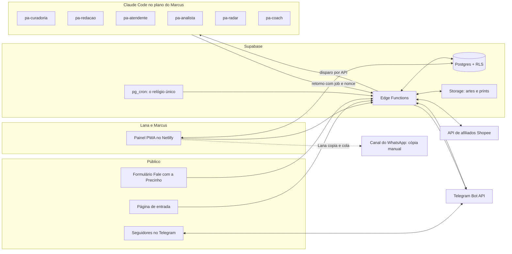

# Precinho de Amiga — Documento de produto

| | |
|---|---|
| Produto | Plataforma Precinho de Amiga: painel com agentes de IA para a operação de afiliada da Lana |
| Dona do negócio | Lana |
| Responsável pelo produto | Marcus Lima |
| Data | 01/11/2026 |
| Versão | 1.0 |
| Arquivos de apoio nesta pasta | `mock/precinho-de-amiga.html` (protótipo navegável), `telas/` (capturas de cada tela), `marca/` (logo e ícone) |
| Contexto de negócio | Documento "Estratégia Lana — Afiliada Shopee" (Claude Docs, privado). Tudo que o software precisa dele foi copiado para cá |

## Como ler este documento

- Este documento é a fonte principal. O mock mostra a intenção de telas, textos e fluxos. Quando o mock e este documento divergirem, **este documento vence**.
- No mock, todo texto entre colchetes (`[Organizador de gavetas]`, `R$ [—]`, `[n]`) é exemplo ou lugar de um dado que virá das integrações. **Nada entre colchetes é dado real** e nada disso deve virar fixture com cara de real. No produto, esses lugares mostram o dado verdadeiro ou um estado vazio explícito ("aguardando dados").
- Os números do mock que estão **sem** colchetes ("5 ofertas", "3 posts", "Esperando você 2", "Comissão padrão 3%", os valores iniciais da calculadora) também são ilustrativos. Só valem como regra os valores repetidos na seção 5 deste documento.
- Alguns textos do mock mudam no produto. A lista está na seção 4.5.
- Valores marcados `[SUPOSIÇÃO]` são escolhas iniciais do dono do produto ou leituras do mock que ainda não foram validadas. O squad pode usá-los e deve registrá-los em `docs/decisions.md`.
- A estratégia original fala em grupos de WhatsApp. **Isso mudou:** a comunidade é feita só de canais (seção 1). Onde houver conflito, vale este documento.
- As datas do plano de 90 dias são calculadas a partir de uma data de início configurável. A data de referência usada no mock é segunda, 2/11/2026.

---

## 1. Visão

**O que é, em uma frase.** Um painel web, usado principalmente no celular, em que oito agentes de IA fazem o trabalho repetitivo da operação de afiliada da Lana (procurar ofertas, escrever, conferir, agendar, atender, divulgar e medir) e ela só aprova, envia e segue um roteiro que cabe no tempo que tem.

**Problema.** A Lana é mãe e tem pouco tempo. A estratégia do Precinho de Amiga exige curadoria diária com desconto real, posts no horário de pico, crescimento da comunidade com permissão e medição para decidir nos dias 30 e 90. Feito à mão, isso consome horas, e o projeto é avaliado justamente pela comissão por hora trabalhada.

**Para quem.**
- Lana: opera o negócio pelo celular, em janelas curtas de tempo.
- Marcus: configura a plataforma, acompanha resultados e decide os gates junto com a Lana.

**Modelo da comunidade (decisão do dono).**
- A comunidade é **só de canais**: um canal do WhatsApp e um canal no Telegram. Sem grupos próprios.
- O crescimento vem de convites pessoais e da divulgação do **link de entrada** em lugares de terceiros, sempre com permissão do administrador.
- As ofertas ficam **só dentro dos canais da Lana**. Fora deles vai apenas o convite para seguir.

**Princípios do produto (valem para todas as funcionalidades).**
1. **A Lana aprova tudo que é público.** Nenhuma oferta ou post sai sem um toque dela. Resposta automática só nos temas que ela aprovou antes.
2. **Nada automático no WhatsApp.** O Telegram publica por bot. No WhatsApp (canal e Status) é sempre copiar e colar, para proteger o número. As diretrizes do WhatsApp tratam automação em massa e apps não oficiais como violação.
3. **Números só do painel de afiliados.** Comissões, pedidos e vendas vêm do relatório oficial. Nada é estimado ou inventado. Onde o dado ainda não existe, a tela diz isso.
4. **Em lugar de terceiros, só o link de entrada.** Link de oferta nunca vai para grupo, canal ou página que não seja da Lana. Ele aparece só nos canais dela e na resposta individual a quem perguntou. O sistema nunca entra em grupos, não posta em lugar de terceiros, não adiciona pessoas e não coleta números.
5. **Todo post leva o aviso "link com comissão"** e preço "de" verdadeiro (Código de Defesa do Consumidor).

**Como vamos saber que deu certo.**
- A Lana cumpre a rotina diária de aprovação e envio em 10 a 20 minutos (meta do plano de 90 dias).
- 100% dos posts publicados passaram pela aprovação dela e pelas checagens da Guardiã.
- Zero envio automático no WhatsApp.
- Os indicadores do gate do dia 30 e do dia 90 saem calculados pela plataforma, a partir do painel de afiliados e das horas registradas, sem planilha paralela.
- Os critérios de negócio (por exemplo, comissão por hora de R$ 7,37 ou mais) pertencem à estratégia: a plataforma mede e mostra, não garante.

---

## 2. Usuários

| Papel | Quem | O que pode fazer | O que não pode |
|---|---|---|---|
| Operadora | Lana | Aprovar, pular ou pedir outra versão de ofertas; copiar e marcar envios do WhatsApp; pedir produtos à Caçadora; gerenciar o Radar; revisar e aprovar respostas da Atendente; informar seguidores do WhatsApp; registrar tempo; marcar tarefas do plano; ver todos os números; ajustar horários dos blocos e dos blocos de revisão | Desligar o aviso "link com comissão"; publicar no Telegram sem passar pela Guardiã; ativar qualquer envio automático no WhatsApp (a função não existe) |
| Dono e administrador técnico | Marcus | Tudo que a Lana vê; configurar integrações, chaves e rotinas; ajustar parâmetros das regras; pausar todos os agentes; ver uso e erros dos agentes | Por padrão, não aprova ofertas nem responde mensagens em nome da Lana `[SUPOSIÇÃO]` (ver seção 11) |
| Seguidor dos canais | Público externo, sem login | Ver posts nos canais; abrir a página de entrada; falar com o bot do Telegram; enviar o formulário "Fale com a Precinho"; (V3) escrever para o número oficial | Ver dados de outros seguidores; acessar o painel |
| Administrador de lugar de terceiros | Público externo | Recebe o pedido de permissão que a própria Lana envia, fora da plataforma | Não interage com a plataforma |
| Agente (conta de serviço) | Cada rotina de IA | Ler a entrada do seu próprio job e gravar o resultado dele | Ler ou alterar dados fora do seu job; publicar qualquer coisa |

Dois usuários com login é o total previsto. Não há cadastro aberto.

---

## 3. Funcionalidades

As prioridades seguem a ordem de construção do mock (aba "Como funciona", seção "Ordem de construção"):

- **Essencial = Versão 1, "Achar e enviar".** Sem isso a plataforma não serve.
- **Importante = Versão 2, "Crescer e medir".**
- **Desejável = Versão 3, "Ampliar".**
- A Versão 4, "Investir" (anúncios e vídeos com IA), está fora de escopo agora. Só o acompanhamento do gatilho de investimento entra, na V2 (seção 9).

Os IDs `F-xx` servem para cruzar este documento com telas, regras e integrações. O squad numera os requisitos (RQ-xx) do jeito dele.

| Entrega | Funcionalidades |
|---|---|
| Primeira fatia (dentro da V1) | F-01, F-02, F-03, F-04, F-06, F-07, F-08, F-13, F-16: fila de ofertas, post montado, Guardiã, Telegram automático, texto pronto para o WhatsApp |
| V1 completa | Primeira fatia + F-05, F-09, F-10, F-11, F-12, F-14, F-15 |
| V2 | F-20 a F-28 |
| V3 | F-30 a F-33 |

**Como a V1 funciona sem os dados da V2:** a cadência fica fixa em 6 posts por dia por canal (as regras de subir e descer dependem da Audiência); o roteiro da tela Hoje só mostra tarefas de telas que já existem; a Guardiã não faz a checagem de queda de seguidores; os números da tela Hoje mostram "aguardando dados" até a importação de conversões da V2. O relatório de conversões cobre períodos passados, então a importação da V2 recupera os dados desde o dia 1.

### 3.1 Essencial (V1: achar e enviar)

**F-01 Acesso.** Lana e Marcus entram com e-mail e link mágico `[SUPOSIÇÃO]`. Dois papéis: operadora e dono. Sessão longa no celular, para ela não precisar entrar toda vez.

**F-02 Coleta de ofertas e histórico de preço.** Todo dia de madrugada o sistema consulta a API de afiliados da Shopee pelos nichos e palavras-chave configurados, guarda dados de produto, loja, avaliação, comissão (padrão e Comissão Extra) e registra o preço de cada produto acompanhado. O histórico de preço é próprio: a Shopee não fornece histórico, então ele começa no dia em que o produto é visto pela primeira vez. Código determinístico, sem IA.

**F-03 Fila "Ofertas para aprovar" (Caçadora de Ofertas).** A Lana abre a aba Ofertas e vê as ofertas do dia, cada uma com foto, nicho, nota de 0 a 100, preço de/por, comissão (com destaque para Comissão Extra e valor estimado em reais por venda, "cerca de R$ [valor]"), os motivos da nota, alertas (por exemplo, "histórico de preço curto") e **a prévia do post completo**, com a frase da Redatora, exatamente como vai sair. A Lana aprova o texto, não só o produto. Filtros: busca por texto, nicho e "Só Comissão Extra". Contador "aprovadas hoje" e estado "Tudo revisado" ao final.

**F-04 Aprovar, pular, editar ou pedir outra versão.** Aprovar monta o post na hora (sem nova chamada de IA) e manda para o agendamento nos dois canais; a Lana pode desmarcar um dos canais naquele post. Pular tira da fila e ensina a Caçadora (o motivo é opcional). Editar permite mudar a frase à mão. Pedir outra versão gera uma nova frase pela Redatora, que volta para a fila.

**F-05 Pedido de produto feito pela Lana.** Na aba Ofertas, campo "procure [produto] até R$ [valor]". Cria um pedido que a Caçadora atende sob demanda; as opções voltam para a fila com a marca "pedido".

**F-06 Montagem do post (Redatora).** Para cada oferta, um texto no formato padrão (seção 5.4) com a frase "por que vale a pena" escrita no tom da Lana, o link de afiliado de cada canal e a arte no modelo da marca. A arte é gerada por modelo fixo (foto do produto, preço, nome, "Siga o canal"), sem IA de imagem.

**F-07 Checagem da Guardiã.** Antes de qualquer post ser agendado e de novo no momento do envio, checagens determinísticas: aviso de comissão presente, preço "de" coerente com o histórico observado, histórico curto sinalizado, cadência do dia dentro do limite, nenhum produto (mesmo item da Shopee) repetido nas últimas 48 horas no mesmo canal e oferta ainda válida. Post reprovado fica "Revisar preço" ou "Pausado até você revisar", nunca sai sozinho. Lista completa na seção 5.3.

**F-08 Agendamento e publicação (Agendadora).** Distribui os posts aprovados nos blocos de pico (padrão entre 18h e 23h). No canal do Telegram, o bot publica sozinho no horário. No canal do WhatsApp, a aba Publicar mostra o texto pronto com "Copiar texto" e "Marcar como enviado", e a Lana recebe um lembrete no horário de cada post.

**F-09 Artes para o Status do WhatsApp.** De 3 a 5 artes por dia (padrão 3), uma por oferta aprovada, escolhidas pelas maiores notas do dia `[SUPOSIÇÃO]`, prontas para ela baixar e postar no Status. O Status é vitrine para atrair seguidores: a arte e a legenda levam o link de entrada com origem `status`, nunca link de oferta. Postagem manual.

**F-10 Tela Hoje.** Data e dia do plano ("dia 1 de 90"), saudação, três destaques (ofertas para aprovar, próximo envio, próxima data de pico), o roteiro do dia montado pelo tempo que ela tem agora (10, 20 ou 40 minutos), as datas que movem vendas, o que a equipe fez desde a meia-noite e os números principais.

**F-11 Registro de tempo.** Botão "começar" e "encerrar" a sessão de trabalho na tela Hoje, com lista das sessões, lançamento e correção manual `[SUPOSIÇÃO]`; o mock só mostra o resultado ("a partir do 1º registro de tempo"). Cada sessão pode ser marcada como "montagem" (cadastro, marca, criação dos canais, planilhas); só o tempo marcado assim fica fora da comissão por hora. Registrar desde o dia 1 é exigência do plano.

**F-12 Painel dos agentes (Como funciona).** Os oito agentes com o que fazem, quando rodam e o que nunca fazem; os dois caminhos (de uma oferta e de um novo seguidor); a ordem de construção; e, no produto real, o estado de cada agente: última execução, próxima, erros e uso do dia contra o teto.

**F-13 Orquestração dos agentes.** Fila de trabalhos (jobs) que dispara as rotinas do Claude Code, recebe os resultados, evita execução duplicada, respeita os limites de uso e tem modo simulado para desenvolvimento e testes. Detalhes no Anexo A.

**F-14 Configurações.** Tela própria (não está no mock), com campos por papel:
- **Lana:** nichos e palavras-chave, nicho principal, horários dos blocos de posts e dos blocos de revisão, data de início do plano, links dos dois canais, quantidade de artes do Status, temas da Atendente que respondem sozinhos.
- **Marcus:** estado das integrações (as chaves em si ficam nos segredos, nunca na tela), parâmetros das regras com os valores iniciais da seção 5, tetos de uso dos agentes, pausa geral dos agentes.

**F-15 Notificações.** Lembrete de cada envio do WhatsApp, aviso de post pausado pela Guardiã e, a partir da V2, mensagens urgentes da Atendente (nível 4). Web Push com o app instalado na tela inicial `[SUPOSIÇÃO]` e, como alternativa, mensagem do bot do Telegram para a própria Lana.

**F-16 Post manual.** Quando a API da Shopee ou os agentes estiverem fora do ar, a Lana cola um link de afiliado que ela mesma gerou no painel, informa preço e prazo, e o post segue o mesmo caminho: formato padrão, Guardiã, agendamento. Não está no mock `[SUPOSIÇÃO]`; é o plano B para ela não parar.

### 3.2 Importante (V2: crescer e medir)

**F-20 Página de entrada com link por origem.** Página pública `[seu-dominio]/entrar?o=<origem>` com a marca, uma frase sobre o canal e dois botões: seguir no WhatsApp e seguir no Telegram. Conta cada clique por origem e por botão, sem guardar dado pessoal.

**F-21 Radar de Comunidades.** Busca semanal de grupos e canais públicos do nicho e da região. Cada lugar mostra nome, tipo, região, regra observada, motivo da indicação e avisos (por exemplo, "a regra do grupo proíbe links. O Radar não recomenda"). Estados: novo, pedir permissão, aguardando resposta, aprovado, recusou, descartado. Mensagens prontas e ajustadas a cada lugar (pedido ao administrador, proposta de troca de divulgação, convite para postar). Ao marcar "Aprovou", a Lana preenche os dias permitidos e o intervalo combinado com o administrador. Cada lugar aprovado ganha o seu link de entrada, o botão "Divulguei hoje" e a "próxima vez permitida", calculada pelos dias e pelo intervalo. Lembrete no dia permitido. Totais no topo: novos, em conversa, aprovados e cliques no mês.

**F-22 Audiência.** Seguidores do Telegram (automático, pelo bot), seguidores do WhatsApp (a Lana informa toda semana, digitando ou enviando um print que a IA lê e ela confirma), novos na semana, saídas, funil da comunidade (cliques no link de entrada, novos seguidores, cliques em ofertas, pedidos), entradas por origem com a leitura das 48 horas seguintes a cada divulgação e engajamento por canal. Gráfico de crescimento após duas semanas de registros.

**F-23 Resultados e Analista.** Importação do relatório de conversões do painel de afiliados, separado por canal pelo código em cada link. Tabela de indicadores com "hoje" e "meta fase 2", calculadora "Quanto preciso vender?", gate do dia 30, gatilho de investimento, regras automáticas com seus valores vigentes e gráfico de comissão por dia após 7 dias de dados. Resumo semanal em texto.

**F-24 Plano de 90 dias (Coach do Plano).** Linha do tempo com as fases e as datas de pico, checklists por período com responsável em texto livre (como no mock: "Lana", "A plataforma faz", "Redatora prepara, Lana envia", "Lana e Marcus"), progresso salvo no servidor. A Coach revisa a semana toda segunda-feira e ajusta o roteiro.

**F-25 Atendente no Telegram e no formulário.** Recebe mensagens do bot do Telegram e do formulário "Fale com a Precinho". Responde sozinha o nível 1; responde sozinha o nível 2 nos temas que a Lana ligou e quando o dado citado está no anúncio (senão, vira rascunho); rascunha o nível 3; chama a Lana no nível 4. Caixa de mensagens com "Aprovar e enviar", "Editar" e "Pedir outra versão", blocos de revisão (12h e 21h, ou só 21h), aviso automático de recebimento e as regras da seção 5.13.

**F-26 Pedidos das amigas.** Lista de pedidos de produto vindos do formulário, do bot ou da própria Lana, com estado (Caçadora procurando, opções encontradas, respondido). Dois pedidos do mesmo produto viram um "achado a pedido" no canal.

**F-27 Crescimento da semana.** Táticas do plano com textos prontos: convite ao núcleo inicial (convite pessoal, nunca adicionar sem pedir), divulgação em lugares aprovados, achados no Status, lista de achados de data (por exemplo, Black Friday) como isca de entrada.

**F-28 Conteúdo extra da Redatora.** Roteiro de vídeo curto de produto (30 segundos, pode ser só mãos e produto), lista de achados para datas de pico e post de "respostas da semana" quando a mesma dúvida se repete.

### 3.3 Desejável (V3: ampliar)

**F-30 Mercado Livre como segunda fonte de ofertas**, se o nicho tiver boa oferta lá e se houver forma oficial de gerar links e ler conversões (a confirmar).

**F-31 Número oficial da Precinho no WhatsApp com a Atendente**, pela WhatsApp Business Platform (API oficial), dentro da janela de 24 horas.

**F-32 Produtos campeões para a loja de dropshipping.** A Analista sugere os produtos que mais venderam pelos canais; a Lana decide. Sem integração com a loja: uma lista exportável.

**F-33 Atendente em tempo real** (níveis 2 e 3 na hora) com chave de API própria, se o dono aprovar o custo (seção 8).

---

## 4. Telas e fluxos

O protótipo navegável está em `mock/precinho-de-amiga.html` (abra no navegador; funciona sem internet, exceto as fontes). As capturas de cada tela, no computador e no celular, estão em `telas/`. A faixa "Protótipo navegável..." do topo do mock não existe no produto.

### 4.1 Navegação

- **Computador:** barra lateral com a marca, as abas e o quadro "Sua equipe agora" (uma linha de estado por agente, por exemplo "Agendadora: bloco às 20h").
- **Celular (prioridade):** a barra vira cabeçalho com as abas roláveis na horizontal. Toda ação diária precisa caber em uma mão, com alvos de toque de pelo menos 44 px.
- **Abas, nesta ordem:** Hoje, Ofertas (com contador de pendentes), Publicar, Radar, Comunidade, Audiência, Resultados, Plano de 90 dias, Como funciona. Configurações (F-14) fica num ícone no topo, fora das abas.
- **Tema claro e escuro**, seguindo o sistema do aparelho (o mock já traz os dois).

### 4.2 Telas do painel

| Tela | Versão | Objetivo | Conteúdo principal | Ações | Estados que precisam existir | Capturas |
|---|---|---|---|---|---|---|
| Hoje | V1 (números na V2) | Mostrar o dia montado em um só lugar | Data e dia do plano; três destaques (para aprovar, próximo envio, próxima data de pico); roteiro pelo tempo disponível; datas que movem vendas; "O que a equipe fez desde a meia-noite"; quatro números (comissão do mês, comissão por hora, seguidores, taxa de saída semanal) | Escolher 10, 20 ou 40 min; marcar tarefa; abrir a tela de cada tarefa; começar e encerrar sessão de trabalho; ver, lançar e corrigir sessões, marcando as de montagem (F-11) | Agentes ainda não rodaram; tudo feito; números aguardando dados; agentes pausados | `telas/01-hoje*.png` |
| Ofertas | V1 | Aprovar as ofertas do dia em poucos toques | Cards com foto, nicho, nota, de/por, comissão e valor por venda (estimado), motivos, alertas e prévia do post completo; filtros; campo de pedido | Aprovar (com os dois canais marcados por padrão); pular; editar a frase; pedir outra versão; ver na Shopee (link comum); procurar; filtrar; pedir produto | Carregando; vazio ("a Caçadora volta na próxima rodada"); tudo revisado; oferta expirada enquanto estava na fila | `telas/02-ofertas*.png` |
| Publicar | V1 | Enviar o bloco do WhatsApp e acompanhar o Telegram | Posts do bloco com horário, selo da Guardiã, texto pronto, estado por canal (Telegram agendado ou pausado; WhatsApp "você envia"); checagem da Guardiã; aviso fixo sobre o WhatsApp; artes do Status | Copiar texto; marcar como enviado; baixar arte; criar post manual (F-16); no post pausado: "Atualizar preço e publicar" (o texto é remontado com o preço atual e passa de novo pela Guardiã) ou "Cancelar post" | Sem posts hoje; post pausado; post publicado; post não enviado no fim do bloco | `telas/03-publicar*.png` |
| Radar | V2 | Encontrar lugares para divulgar o link de entrada, com permissão | Quatro totais; lista filtrável (todos, novos, em conversa, aprovados); mensagens prontas; links de entrada por origem com cliques; regras do Radar | Adicionar à lista; descartar; copiar pedido ao admin; "já pedi"; aprovou (com dias permitidos e intervalo combinado); recusou; copiar convite; copiar link; "Divulguei hoje" | Sem lugares novos; lugar com aviso; lugar recusado não volta; próxima vez permitida ainda no futuro | `telas/04-radar*.png` |
| Comunidade | V2 | Atender sem ficar no celular o dia todo e crescer a base | Caixa de mensagens (respondidas sozinhas, esperando você, urgentes); níveis 1 a 4; rascunhos para aprovar; pedidos das amigas; regras da Atendente; táticas de crescimento da semana; audiência em resumo | Aprovar e enviar; editar; pedir outra versão; escolher blocos de revisão; desligar uma resposta automática; copiar convites | Caixa vazia; mensagem urgente; janela de 24 horas perto de fechar (V3) | `telas/05-comunidade*.png` |
| Audiência | V2 | Saber quem chega, de onde vem, quem fica e quem compra | Linha de base; quatro totais; funil; registro semanal do WhatsApp; de onde vem cada número; entradas por origem; engajamento por canal; gráfico de crescimento | Salvar seguidores do WhatsApp; enviar print; confirmar número lido do print | Nenhum registro ainda ("o primeiro vira a linha de base"); leitura misturada (duas divulgações a menos de 48 horas uma da outra); menos de duas semanas de dados | `telas/06-audiencia*.png` |
| Resultados | V2 | Medir e decidir pelos números do painel | Indicadores (hoje e meta fase 2); calculadora "Quanto preciso vender?"; gate do dia 30; gatilho de investimento; regras automáticas com valor vigente; comissão por dia | Mexer na calculadora; definir metas da fase 2 (no gate); registrar a decisão do gate | Linha de base em construção; menos de 7 dias de dados; importação com erro | `telas/07-resultados*.png` |
| Plano de 90 dias | V2 | Transformar o plano em tarefas que cabem na semana | Linha do tempo com fases e marcos; checklists por período com responsável | Marcar e desmarcar tarefas | Semana atual em destaque; tarefa atrasada | `telas/08-plano*.png` |
| Como funciona | V1 | Explicar e mostrar o estado dos agentes | Três princípios; caminho de uma oferta; caminho de um novo seguidor; cards dos oito agentes (o que fazem, quando, nunca); ordem de construção; no produto, estado e uso de cada agente | Pausar e retomar agentes (só Marcus) | Agente com erro; teto do dia atingido | `telas/09-agentes*.png` |
| Configurações | V1 | Ajustar o que muda com o tempo, sem mexer no código | Campos por papel, como descrito em F-14 | Salvar; voltar ao valor inicial de uma regra | Integração desconectada; campo só para Marcus aparece bloqueado para a Lana | Não está no mock |

### 4.3 Telas públicas (não estão no mock)

- **Página de entrada** `[seu-dominio]/entrar?o=<origem>`: logo, uma frase ("achados que eu mesma compraria, com desconto de verdade"), botões "Seguir no WhatsApp" e "Seguir no Telegram", aviso curto de privacidade. Origem desconhecida ou ausente conta como "direto".
- **Formulário "Fale com a Precinho"** `[seu-dominio]/fale`: o que você procura ou sua dúvida; faixa de preço (opcional); primeiro nome (opcional); como prefere receber a resposta (pelo canal, como "achado a pedido", ou por WhatsApp, informando o número) com consentimento explícito; aviso de privacidade. O link fica fixado na descrição dos dois canais.
- **Bot do Telegram** (conversa privada): mensagem de boas-vindas com aviso de privacidade e um menu de botões para o nível 1 (cupom, link que não abre, como funciona o canal, a oferta ainda vale, problema com entrega, fazer um pedido, falar com a Lana). Texto livre vai para a Atendente. Comando para apagar os próprios dados.

### 4.4 Fluxos principais

**Fluxo A — caminho de uma oferta (todo dia).**
1. Madrugada: a coleta grava ofertas e preços do dia (F-02).
2. A rotina de curadoria escolhe as candidatas, escreve as frases e revisa os textos (Caçadora, Redatora e Guardiã no mesmo trabalho). Cada card já chega com a prévia do post.
3. A Lana abre Ofertas e aprova ou pula. Cada aprovação monta o post na hora (modelo fixo, sem nova chamada de IA) e passa pelas checagens determinísticas da Guardiã.
4. A Agendadora coloca o post no bloco. No horário, a Guardiã confere o preço de novo; o bot publica no Telegram e a Lana recebe o lembrete do WhatsApp.
5. A Lana copia, cola no canal do WhatsApp e marca como enviado.
6. (V2) O relatório de conversões volta com o código de cada canal; a Analista atualiza os indicadores, e o que vendeu ajusta a busca da Caçadora e o roteiro do dia seguinte.

**Fluxo B — pedido de produto.**
1. O pedido chega pela Lana (aba Ofertas), pelo formulário ou pelo bot.
2. A Caçadora procura sob demanda e devolve até [2] opções dentro da faixa de preço `[SUPOSIÇÃO a partir do mock]`.
3. Se o pedido veio de um seguidor, a Atendente rascunha a resposta com as opções e o aviso de comissão; a Lana aprova no bloco de revisão.
4. Dois pedidos do mesmo produto viram um post "achado a pedido" no canal, que entra na fila de aprovação como qualquer oferta.

**Fluxo C — caminho de um novo seguidor.**
1. O Radar encontra lugares e confere a regra de cada um.
2. A Lana adiciona à lista e copia o pedido de permissão ao administrador; marca "já pedi".
3. Aprovado, a Lana informa os dias permitidos e o intervalo combinado, e o lugar ganha o link de entrada próprio. Quando há um lugar com a vez liberada e a última divulgação tem mais de 48 horas, o roteiro sugere "divulgar seu link em um lugar aprovado".
4. A Lana copia o convite com o link, posta ela mesma no lugar e toca em "Divulguei hoje".
5. A página de entrada conta o clique e leva ao canal escolhido.
6. A Audiência cruza os cliques daquela origem com o crescimento nas 48 horas seguintes.

**Fluxo D — mensagem de um seguidor.**
1. A mensagem chega pelo bot ou pelo formulário (V3: também pelo número oficial).
2. Aviso automático de recebimento (seção 5.13).
3. Nível 1: resposta automática na hora. Nível 4 com palavra-chave conhecida: notificação imediata para a Lana. O resto vai para o próximo ciclo da Atendente (a cada 30 minutos, das 8h às 22h30): nível 2 sai sozinho se o tema estiver ligado e o dado estiver no anúncio, senão vira rascunho; nível 3 vira rascunho; nível 4 identificado no ciclo notifica a Lana.
4. Nos blocos de revisão, a Lana aprova, edita ou pede outra versão (que volta no ciclo seguinte). Resposta de categoria fixa aprovada 3 vezes sem edição pode virar automática (seção 5.13).

**Fluxo E — registro semanal do WhatsApp.**
1. Segunda-feira, o roteiro inclui "Atualizar os seguidores do WhatsApp" (2 min).
2. A Lana digita o total ou envia um print.
3. Com print, a IA lê o número e a Lana confirma antes de salvar. Nada lido de print é salvo sem confirmação.

**Fluxo F — gate do dia 30.**
1. No dia do gate, Resultados mostra comissão por hora, comissão por 1.000 seguidores, quedas semanais e a recomendação calculada pela regra (escalar, ajustar ou parar), com o aviso sobre o efeito de novembro.
2. Lana e Marcus registram a decisão e as metas da fase 2.
3. As metas preenchem a coluna "Meta fase 2" dos indicadores.

**Fluxo G — primeiro uso.**
1. Marcus conecta as chaves (Shopee, Telegram, rotinas) e confere o estado de cada integração.
2. A Lana informa nichos e palavras-chave, nicho principal, links dos dois canais, data de início e horários.
3. A primeira coleta roda na hora (sem esperar a madrugada) para a fila não começar vazia.

### 4.5 Textos do mock que mudam no produto

| Onde no mock | Texto do mock | No produto |
|---|---|---|
| Ofertas, aviso ao aprovar | "Aprovada. A Redatora já está escrevendo o post." | "Aprovada. O post já está montado e agendado." |
| Ofertas, fim da fila | "As aprovadas já foram para a Redatora." | "As aprovadas já estão agendadas." |
| Ofertas, card | "Você recebe R$ [valor] por venda" | "Cerca de R$ [valor] por venda" |
| Ofertas, card | Sem prévia do texto | Prévia do post completo (F-03) |
| Publicar, post com histórico curto | "Revisar preço" e Telegram "Pausado até você revisar" | Histórico curto é só alerta na aprovação e o post sai sem de/por. "Revisar preço" e pausa ficam para quando o preço muda antes do envio (seção 5.3) |
| Como funciona, Redatora | "Quando: logo após cada aprovação" | "Quando: na rodada diária e quando você pede outra versão" |
| Como funciona, fontes | "Mercado Livre (mês 2)" | "Mercado Livre (versão 3)" |
| Resultados, regras automáticas | "A Analista recalibra no dia 90" | "Lana e Marcus recalibram no dia 90, com os números da Analista" |
| Comunidade, introdução | Mensagens "pelo número oficial da Precinho" | Na V2, só bot do Telegram e formulário; número oficial a partir da V3 |
| Audiência, entradas por origem | "Divulgar em um lugar por dia deixa essa leitura limpa" | "Espaçar as divulgações em 48 horas deixa essa leitura limpa" |
| Comunidade, crescimento | "3 a 5 achados por dia no Status" com "Artes prontas na aba Publicar" | Igual, e a arte leva o link de entrada, não link de oferta |

---

## 5. Regras de negócio

Toda regra desta seção tem resposta certa e fica em **código determinístico com testes**, nunca em modelo de IA. A IA escolhe, escreve e resume; quem decide limite, cálculo e permissão é o código. Os valores são iniciais: a Analista mostra quando cada regra disparou, e a recalibração do dia 90 é feita por Lana e Marcus.

### 5.1 Regras invioláveis (testes de aceite obrigatórios)

1. Nenhum post vai para o Telegram sem aprovação da Lana e sem passar pela Guardiã.
2. Não existe nenhum caminho de código que envie mensagem para canal, grupo ou Status do WhatsApp.
3. Todo post publicado contém o texto "Link com comissão".
4. Link de oferta só é gerado para três destinos: posts dos canais da Lana (`wa`, `tg`) e respostas individuais da Atendente a quem perguntou (`at`). Mensagens do Radar e artes do Status só contêm link de entrada.
5. Nenhum número de comissão, pedido ou venda aparece sem ter vindo do painel de afiliados. Valor por venda na fila de ofertas aparece como estimativa ("cerca de").
6. Nenhum texto gerado por IA é publicado ou enviado sem aprovação, com uma única exceção: respostas do nível 2 em temas que a Lana ligou, quando o código confirma que o dado citado está escrito no anúncio. Respostas do nível 1 e respostas que viraram automáticas não são exceção: são textos fixos já aprovados, montados por código, sem texto novo de IA.
7. O botão "ver na Shopee" usado pela Lana abre o link comum do produto, nunca o de afiliado (comprar pelo próprio link zera a comissão e arrisca a conta).

### 5.2 Curadoria e nota da oferta

Critérios da estratégia (toda oferta passa por eles): desconto real comparado ao histórico recente, nunca "de/por" inflado; loja e produto bem avaliados, com volume de vendas que dê segurança; prioridade para Comissão Extra ou ticket maior; produto que a Lana indicaria para uma amiga; oferta com prazo claro ganha destaque.

| Regra | Valor inicial |
|---|---|
| Janela do histórico | Últimos 30 dias observados `[SUPOSIÇÃO]` |
| Preço de referência ("de") | Mediana dos preços observados na janela `[SUPOSIÇÃO]` |
| Desconto real | Preço atual pelo menos [10]% abaixo da referência `[SUPOSIÇÃO]` |
| Histórico curto | Menos de 7 dias de observação: alerta "Histórico de preço curto: observado há [n] dias. Confira o preço antes de aprovar." e o post sai sem "de/por", só com "Por R$ [preço atual]" `[SUPOSIÇÃO]`. Na primeira semana, quase nenhum post terá de/por; é o esperado |
| Origem do preço "de" | Só a mediana calculada pela plataforma. O "preço original" do anúncio da Shopee não é usado. No post manual (F-16), o "de" digitado pela Lana só aparece se houver histórico e não passar do maior preço observado na janela |
| Eliminatórios | Loja abaixo de [nota mínima] ou com menos de [n] avaliações; produto sem estoque; nicho bloqueado `[SUPOSIÇÃO, valores a definir]` |
| Nota de 0 a 100 | Soma ponderada: desconto real [35], comissão em reais por venda [25], avaliação e volume [20], aderência ao nicho ou a um pedido [10], prazo claro [10] `[SUPOSIÇÃO]` |
| Tamanho da fila do dia | Maior cadência vigente entre os dois canais + 2 `[SUPOSIÇÃO]` |
| Comissão por venda exibida | Preço atual × taxa (padrão ou Extra), rotulada como estimativa: a Shopee calcula sobre o valor líquido, sem impostos, cupons e frete |

A Caçadora (IA) escolhe entre as [30] de maior nota `[SUPOSIÇÃO]`, equilibra os nichos, evita repetir produto e escreve os motivos em linguagem simples. Ofertas fora do nicho principal entram marcadas ("útil para testar [nicho] na matriz de nicho"). Pulos com motivo e vendas por categoria ajustam os pesos da busca a partir da V2.

### 5.3 Checagens da Guardiã

| Checagem | Quando | Resultado se falhar |
|---|---|---|
| Aviso "Link com comissão" presente | Na montagem | Bloqueia |
| Link de afiliado válido e com o código do canal | Na montagem | Bloqueia |
| Mesmo produto (mesmo item da Shopee) no mesmo canal nas últimas 48 horas | No agendamento | Bloqueia naquele canal |
| Cadência do dia atingida no canal | No agendamento | Bloqueia naquele canal; o post segue no outro canal, se houver vaga. Sem vaga em nenhum, fica para o dia seguinte, se ainda valer |
| Preço "de" que não é a mediana calculada, ou "de" manual (F-16) acima do maior preço observado ou sem histórico | Na montagem | Tira o "de/por"; o post sai só com "Por R$ [preço atual]" |
| Histórico curto | Na montagem | Alerta na aprovação e post sem "de/por" (seção 5.2) |
| Texto com promessa que o anúncio não sustenta (por exemplo, "menor preço do Brasil", "garantido") | Em todo texto gerado por IA (curadoria, redação, Radar, Atendente), pela IA da própria rotina | Alerta com o trecho marcado |
| Preço atual acima do preço do post, oferta encerrada ou sem estoque | 5 minutos antes do envio `[SUPOSIÇÃO]` | Pausa o post do Telegram e avisa a Lana; no WhatsApp, troca o selo para "Revisar preço" |
| Taxa de saída semanal acima do limite (seção 5.7) | Toda segunda, a partir da V2 | Alerta e aplica a regra de cadência no canal |

### 5.4 Formato padrão do post

```
*[Produto]*
De R$ [preço de referência] por R$ [preço atual]
Cupom: [código]
[Frase da Redatora: por que vale a pena]
[link]
Oferta válida até [prazo] | Link com comissão
```

- A linha do cupom só aparece se houver cupom. "Oferta válida até" só aparece se a oferta tiver prazo; sem prazo, a última linha é só "Link com comissão".
- Sem desconto real confirmado ou com histórico curto, a segunda linha vira "Por R$ [preço atual]".
- O negrito usa `*texto*` no WhatsApp e o formato do Telegram (HTML ou Markdown do bot) no Telegram.
- A frase da Redatora tem até [140] caracteres `[SUPOSIÇÃO]`, no tom de amiga que indica: direto, sem exagero, sem pressão.
- Se a Redatora estiver indisponível, o post sai sem a frase, nunca com texto inventado pelo código.

### 5.5 Links e códigos de origem

Cada post gera um link de afiliado por canal com códigos de rastreio (subIDs; a Shopee aceita até cinco, a confirmar na documentação oficial):

| Código | Conteúdo |
|---|---|
| sub1 | Destino: `wa` (canal do WhatsApp), `tg` (canal no Telegram), `at` (resposta individual da Atendente). O Status não usa link de oferta |
| sub2 | ID do post |
| sub3 | Data do bloco (AAAAMMDD) |
| sub4 | Origem da oferta: `rodada` ou `pedido` |
| sub5 | Livre (reservado) |

A Analista agrupa cliques, pedidos e comissão por `sub1` para "Engajamento por canal".

### 5.6 Agendamento e cadência

| Regra | Valor |
|---|---|
| Janela de pico | Entre 18h e 23h (horário de Brasília) |
| Bloco padrão | Bloco da noite das 20h às 23h `[SUPOSIÇÃO a partir do mock]`; bloco do almoço opcional, desligado no início |
| Distribuição dos posts | O primeiro post sai no início do bloco. Intervalo = o menor entre 40 minutos e (duração do bloco ÷ número de posts), nunca abaixo de 20 minutos `[SUPOSIÇÃO]`. Exemplos: 3 posts às 20:00, 20:40 e 21:20 (como no mock); 6 posts de 30 em 30 minutos, das 20:00 às 22:30 |
| Quando não cabe | Se o número de posts a 20 minutos não couber no bloco, o início do bloco recua até o limite de 18h. Exemplo: 10 posts começam às 19:40 |
| Datas de pico | 11.11, Black Friday, 12.12 e Natal: posts concentrados entre 18h e 23h e aquecimento dos canais 2 a 3 dias antes |
| WhatsApp não enviado | Se a Lana não marcar o post como enviado até o fim do bloco, ele vira "não enviado" e não conta na cadência daquele canal |
| Status do WhatsApp | De 3 a 5 artes por dia (padrão 3), fora da cadência dos canais, só com link de entrada |

**Cadência é teto, não meta:** é o máximo de posts por dia em cada canal. Se a Lana aprovar menos, sai menos. Um post aprovado vai para os dois canais por padrão; se um canal já atingiu o teto, o post sai só no outro.

Cadência (vale para cada canal separadamente; na V1 fica fixa em 6 até existirem dados de audiência):

| Quando dispara | O que acontece |
|---|---|
| Início | 6 posts por dia por canal |
| 2 semanas seguidas com taxa de saída até 1% e cliques por post sem cair mais de 10% | Mais 1 post por dia, até 10 |
| Taxa de saída semanal acima do limite de queda (3% no início) | Menos 2 posts por dia |
| Taxa de saída acima de 5% em uma semana | Um dia sem posts naquele canal e revisão da curadoria com a Lana |
| Depois de 4 semanas de dados | O limite de queda passa a ser o dobro da taxa de saída média semanal do canal, contido entre 2% e 5% |

Leituras fixadas `[SUPOSIÇÃO]`:
- "Queda de seguidores" nas regras é sempre a **taxa de saída semanal** da seção 5.7, calculada por canal.
- "Cliques por post sem cair mais de 10%" compara a média das duas últimas semanas com a das duas anteriores.
- Depois de uma redução, o canal só volta a subir pela regra normal (+1 a cada 2 semanas que cumpram a condição), a partir do valor reduzido.
- O mínimo depois de reduzir é 2 posts por dia.
- A regra de 5% é fixa e não muda com a recalibração.
- O gate do dia 30 usa os 3% como escritos.

### 5.7 Indicadores

| Indicador | Cálculo | Frequência |
|---|---|---|
| Comissão bruta do mês | Soma das comissões do relatório de conversões no mês, sem as canceladas | Diária |
| Comissão líquida do mês | Valor efetivamente pago pela Shopee referente ao mês, após retenções (pessoa física: 11% de INSS e IRRF) | Mensal, quando o pagamento sai |
| Comissão por hora trabalhada | Comissão bruta do período ÷ horas registradas no período, sem as marcadas como montagem. Quando o pagamento do mês sai, aparece também a versão com a líquida | Semanal e no gate |
| Seguidores | Canal do WhatsApp (último registro semanal) + canal no Telegram (bot) | Semanal |
| Taxa de saída semanal, por canal | Telegram: saídas registradas pelo bot na semana ÷ inscritos no início da semana. WhatsApp: "deixaram de seguir" informado pela Lana ÷ seguidores no início da semana; sem essa informação, queda líquida do total (início − fim, nunca negativa) ÷ início | Semanal |
| Cliques por oferta | Cliques ÷ ofertas postadas | Diária |
| Conversão | Pedidos ÷ cliques | Semanal |
| Ticket médio | Valor dos pedidos ÷ pedidos | Mensal |
| Mix de Comissão Extra | Comissão de itens com Comissão Extra ÷ comissão total | Mensal |
| Comissão por 1.000 seguidores | Comissão ÷ (seguidores ÷ 1.000) | Mensal |

- **Bruta e líquida não se misturam.** Enquanto o pagamento não sai, a tela mostra a bruta e "líquida aguardando pagamento". Se a API não trouxer o pagamento, a Lana informa o valor recebido uma vez por mês `[SUPOSIÇÃO]`.
- **Saídas no WhatsApp.** O WhatsApp não entrega esse dado a outros apps. Se o app dela mostrar quantos deixaram de seguir, a Lana informa (campo opcional); senão, usa a queda líquida do total. Atenção: enquanto o canal cresce, a queda líquida fica perto de zero e as regras de cadência quase não disparam no WhatsApp. A tela diz qual dos dois cálculos foi usado e lembra a Lana de informar as saídas quando o app mostrar.
- **Base de cada número:** a tela Hoje mostra a comissão bruta do mês, rotulada "bruta". Resultados mostra bruta e líquida em linhas separadas. Gates usam a bruta (com a líquida ao lado quando existir). O gatilho de investimento usa só a líquida, inclusive no valor por hora.
- **Escopo das regras de queda:** a cadência usa a taxa de cada canal. Os gates e o gatilho de investimento consideram uma semana "acima do limite" se qualquer um dos dois canais passou do limite naquela semana.
- **Comissão do gate do dia 30** `[SUPOSIÇÃO]`: no dia 30 o pagamento de novembro ainda não saiu (pessoa física recebe até o dia 10). O gate usa a comissão bruta dos dias 1 a 30 (pendentes e concluídas, sem canceladas), rotulada assim, e é recalculado quando o pagamento chegar.
- **Funil.** Os apps não identificam a pessoa; o funil compara totais do mesmo período e as taxas são aproximadas. A tela diz isso.

### 5.8 Gates

Referência: o valor-hora do salário mínimo de 2026, R$ 7,37 (R$ 1.621 ÷ 220 horas). A comissão por hora conta só a operação, sem as horas de montagem.

Avaliadas nesta ordem; vale a primeira que se aplicar (h = comissão por hora do período; "semana acima" = pelo menos uma semana do período com taxa de saída acima de 3% em algum canal):

| Ordem | Condição | Resultado |
|---|---|---|
| 1 | h < R$ 3,68 e sem alta nas duas últimas semanas | Parar ou repensar |
| 2 | h < R$ 7,37 (inclui abaixo de R$ 3,68 com alta) ou semana acima | Ajustar nicho ou curadoria, com nova leitura no dia 60 |
| 3 | h ≥ R$ 7,37 e nenhuma semana acima | Escalar |

- No gate do dia 30, qualquer resultado vem com o aviso: novembro tem 11.11 e Black Friday; o "escalar" só vira definitivo se as semanas comuns de dezembro mantiverem o resultado.
- O gate do dia 90 usa o mesmo cálculo e decide formalização e novos marketplaces.
- "Nova leitura no dia 60" é um ponto de verificação na mesma tela de Resultados, com o mesmo cálculo, que só aparece se o dia 30 deu "Ajustar". Não é um gate novo.
- "Sem alta nas duas últimas semanas" = a comissão por hora da última semana não é maior que a da semana anterior `[SUPOSIÇÃO]`.
- A plataforma calcula e recomenda; a decisão é registrada por Lana e Marcus.

### 5.9 Gatilhos de formalização e de investimento

| Regra | Quando dispara | O que acontece |
|---|---|---|
| Formalização | Comissão bruta acima de R$ 3.000 por 2 meses seguidos | Alerta para conversar com contador antes de chegar a R$ 5.000, limite da isenção mensal de IR (Lei 15.270/2025). A plataforma não faz nada fiscal |
| Gatilho de investimento (V4) | Comissão líquida de R$ 1.621 ou mais por 3 meses seguidos, com R$ 7,37/h ou mais no mesmo período, 8 semanas de dados de audiência e queda de seguidores dentro do limite nas últimas 4 semanas | Mostra "Versão 4 liberada" em Resultados. A execução da V4 está fora de escopo |
| Anúncios (V4, só registro) | Investimento liberado | Mês de teste com 10% da comissão líquida do mês anterior; sobe para 20% se o custo ficar abaixo do teto |
| Anúncios (V4, só registro) | Sempre | Custo por novo seguidor de até metade do valor do seguidor; o anúncio leva ao canal, nunca a um link de oferta |
| Anúncios (V4, só registro) | Custo acima do teto por 2 semanas, ou queda acima de 3% durante a campanha | Pausa e revisão do criativo |
| Vídeos com IA (V4, só registro) | Investimento liberado e 8 vídeos manuais medidos | Até 10% da comissão líquida; anúncios e vídeos somados ficam em até 30% |
| Vídeos com IA (V4, só registro) | Cliques por vídeo abaixo da média dos vídeos manuais por 4 semanas | Volta para vídeo manual |

Resultados mostra o progresso do gatilho: "Comissão líquida do mês: R$ [valor] de R$ 1.621. Meses seguidos acima: [n] de 3."

**Valor do seguidor** = comissão líquida do mês ÷ seguidores × meses que um seguidor fica. Meses que ele fica = 1 ÷ queda mensal de seguidores, contando no máximo 6; com queda mensal zero ou negativa, conta 6. A queda mensal é a soma das taxas de saída semanais do mês, nos dois canais ponderados pelo tamanho `[SUPOSIÇÃO]`. Exemplo de leitura, com números fictícios: comissão de R$ [A], [B] seguidores e queda mensal de [C]% → valor = (A ÷ B) × mín(6, 100 ÷ C).

### 5.10 Calculadora "Quanto preciso vender?"

Vendas atribuídas necessárias = comissão bruta desejada ÷ comissão média. Padrões do mock: R$ 1.000 desejados e 8% de média, resultando em R$ 12.500 por mês, cerca de R$ 417 por dia (mês de 30 dias), valores antes das retenções. Os campos são livres; a média é um cenário, não uma taxa garantida.

### 5.11 Radar de Comunidades

1. Fora dos canais da Lana vai só o link de entrada. Link de oferta, nunca.
2. Sempre com permissão do administrador e no dia que a regra do lugar permite. Os dias permitidos ficam num campo do lugar, preenchido pela Lana quando ela marca "Aprovou".
3. Uma divulgação por lugar, no intervalo combinado com o administrador (campo do lugar). "Divulguei hoje" registra a data e calcula a próxima vez permitida.
4. Nada é automático: o Radar não entra em grupos, não posta, não adiciona pessoas e não coleta números.
5. Lugar que recusou não volta para a lista. Lugar descartado também não.
6. Lugar cuja regra proíbe links aparece com aviso e só com a opção "Descartar".
7. A busca usa apenas páginas públicas. Sem login em redes sociais e sem raspagem automatizada de plataformas que proíbem isso.
8. O roteiro só sugere uma divulgação quando a anterior tem mais de 48 horas, para a leitura de 48 horas ficar limpa. A Lana pode divulgar mais vezes por conta própria; as leituras que se sobrepõem ficam marcadas como "misturadas".
9. Cada lugar aprovado ganha uma origem única (`o=<slug>`) e o seu link de entrada.

### 5.12 Audiência e leitura por origem

- **Telegram:** inscritos e saídas pelos eventos do bot no canal; total diário pela contagem de membros.
- **WhatsApp:** total informado pela Lana toda semana (ou lido de print e confirmado). O primeiro registro vira a linha de base.
- **Entradas por origem:** para cada divulgação registrada, cliques no link daquela origem e crescimento dos dois canais nas 48 horas seguintes. Se houver duas divulgações no mesmo período de 48 horas, a leitura fica marcada como "misturada" e não é atribuída a nenhuma.
- **Gráfico de crescimento:** só depois de duas semanas de registros.
- **Engajamento por canal:** posts na semana, cliques por post, pedidos e comissão, por `sub1`.

### 5.13 Atendente

| Nível | O que é | Como responde | Quando |
|---|---|---|---|
| 1 | Cupom, link que não abre, como funciona o canal, se a oferta ainda vale, problema com entrega (orienta abrir na Shopee) | Sozinha, por botão do menu ou regra de palavra-chave, com textos fixos que a Lana aprovou antes; o código só preenche campos (link, cupom, preço) | Na hora, 24 horas por dia |
| 2 | Medidas, cores e prazo, só quando a informação está escrita no anúncio | Sozinha, se o tema estiver ligado nas Configurações e o código confirmar que o trecho citado aparece no texto do anúncio. Sem isso, vira rascunho do nível 3 | No próximo ciclo da Atendente |
| 3 | Pedidos de produto (com opções da Caçadora) e dúvidas que o anúncio não responde | Rascunho para a Lana aprovar | Nos blocos de revisão |
| 4 | Reclamação séria, proposta de parceria, ofensa ou assunto fora do tema | Chama a Lana | Notificação na hora para palavras-chave conhecidas; para o resto, no próximo ciclo |

Ciclos da Atendente: a cada 30 minutos, das 8h às 22h30 (30 ciclos por dia), só quando há mensagem pendente. Mensagens que chegam depois do último ciclo esperam o ciclo das 8h; o nível 1 continua respondendo a noite toda.

Regras:
- **Blocos de revisão:** 12h e 21h, ou só 21h (a Lana escolhe; padrão 12h e 21h `[SUPOSIÇÃO]`).
- **Aviso na hora:** "Oi! Sou a assistente da Precinho de Amiga. Respondo agora o que der, e o resto a Lana responde até as [horário do próximo bloco]." À noite, o horário do próximo bloco é o do dia seguinte.
- **Vira automática:** vale só para as categorias fechadas dos níveis 1 e 2 (cupom, link que não abre, como funciona, a oferta ainda vale, entrega, medidas, cores, prazo). Quando a Lana aprova 3 vezes seguidas, sem editar, a resposta de uma categoria, aquele texto vira modelo fixo e passa a sair sozinho, com os campos preenchidos por código. Nunca vira automática uma resposta de nível 3 ou 4. Dá para desligar cada uma.
- **Uma resposta para todas:** 3 pessoas com a mesma dúvida na semana viram um post de respostas no canal (entra na fila de aprovação). 2 pedidos do mesmo produto viram um achado a pedido.
- **Silêncio:** fora dos blocos de revisão, a Atendente só faz o celular tocar no nível 4. Os lembretes de envio do WhatsApp e os avisos da Guardiã seguem tocando, porque fazem parte do bloco de posts.
- **Limites:** nunca pede CPF, endereço ou dados de pagamento; nunca promete preço ou estoque além do anúncio; sempre oferece falar com a Lana; nunca finge ser a Lana; não responde fora dos temas da Precinho.
- **Links nas respostas:** link de afiliado com `sub1=at` e o aviso "Os links geram comissão para a Precinho".
- **WhatsApp (V3):** responde em até 24 horas da última mensagem da pessoa, regra da API oficial. Desde 01/10/2026 as mensagens de serviço são cobradas depois de 1.000 grátis por número por mês; a tela mostra o consumo do mês.
- **Formulário com resposta por WhatsApp (V2):** sem número oficial, a resposta aprovada abre o WhatsApp da Lana com o texto preenchido (link de conversa do próprio WhatsApp) e ela toca em enviar. Nada é enviado sozinho.

### 5.14 Roteiro do dia

A Coach monta a lista pelo tempo que a Lana tem agora: ordena as tarefas pendentes por prioridade, percorre a lista e inclui cada tarefa que ainda cabe no tempo restante, pulando a que não cabe e seguindo para a próxima (como no código do mock). Tempos: 10, 20 ou 40 minutos; padrão 20. Na V1, só entram tarefas de telas que já existem. O rodapé diz quanto tempo foi usado e quantas tarefas ficaram para depois. Catálogo inicial (do mock):

| Tarefa | Prioridade | Minutos | Leva para |
|---|---|---|---|
| Aprovar as ofertas do dia | 1 | 5 | Ofertas |
| Enviar o bloco da noite no canal do WhatsApp | 1 | 5 | Publicar |
| Divulgar seu link em um lugar aprovado (só com lugar liberado e última divulgação há mais de 48 horas) | 2 | 3 | Radar |
| Postar achados no Status do WhatsApp | 2 | 3 | Publicar |
| Atualizar os seguidores do WhatsApp (só às segundas) | 2 | 2 | Audiência |
| Revisar a caixa de mensagens (só com pendências) | 2 | 5 | Comunidade |
| Tarefa da semana do plano (por exemplo, preencher a matriz de nicho) | 3 | 10 | Plano |
| Gravar um vídeo curto de produto (roteiro pronto) | 3 | 9 | Comunidade |

Tarefas sem objeto no dia (nenhuma oferta, nenhuma mensagem, dia não permitido) não aparecem. Os minutos de cada tarefa podem ser recalibrados com o tempo real registrado `[SUPOSIÇÃO]`.

### 5.15 Registro de tempo

- Sessão começa e termina por botão; sessão aberta por mais de [2] horas sem atividade fecha sozinha no último uso registrado e pede confirmação `[SUPOSIÇÃO]`.
- A Lana pode lançar e corrigir tempo manualmente (por exemplo, tempo gasto no WhatsApp fora do app).
- Só o tempo marcado como "montagem" fica fora da comissão por hora. A rotina diária da semana 1 (aprovar e enviar) conta normalmente, porque a comissão dessa semana também entra no gate.

### 5.16 Calendário e plano

- Data de início configurável (referência do mock: segunda, 2/11/2026, que é o dia 1). "Dia N de 90" é calculado a partir dela e para em 90; depois disso a tela diz "plano de 90 dias concluído".
- Cada gate acontece na manhã seguinte ao fim do dia N e se chama "Gate do dia N". Com início em 2/11/2026: o dia 30 é terça, 1/12, e o gate do dia 30 é quarta, 2/12/2026; o dia 90 é sábado, 30/1/2027, e o gate do dia 90 é domingo, 31/1/2027. O ponto de verificação do dia 60 (seção 5.8), quando existir, segue a mesma lógica.
- Fases do mock: preparação (2 a 8/11), temporada de ofertas (9/11 a 13/12), Natal e ajustes (14 a 31/12), escala (janeiro).
- Datas de pico em 2026: 11.11 (quarta), Black Friday 27/11 (sexta), 12.12 (sábado), Natal. As datas ficam numa tabela editável, para os anos seguintes.
- Checklists e responsáveis do plano: como estão na aba Plano de 90 dias do mock.

### 5.17 Os oito agentes

| Agente | O que faz | Quando roda | Onde roda | Nunca |
|---|---|---|---|---|
| Caçadora de Ofertas | Escolhe as ofertas do dia entre as melhores notas, explica os motivos e atende pedidos | Rodada diária de madrugada e sob demanda | Coleta e nota em código; escolha em rotina de IA | Indica loja mal avaliada ou "de/por" sem histórico |
| Redatora | Frase de cada post, outra versão, roteiros de vídeo, listas de datas, mensagens do Radar, rascunhos da Atendente | Na rodada diária e sob demanda | É um papel dentro de quatro rotinas: curadoria (frases do dia), redação (outra versão, listas, roteiros, post de respostas), Radar (mensagens de cada lugar) e Atendente (rascunhos). Montagem do post e da arte em código | Publica sozinha |
| Guardiã | Barra post com problema e acompanha sinais de risco | Na montagem, no agendamento e antes do envio | Código (checagens); IA só para revisar promessas no texto | Libera post sem aviso de comissão |
| Agendadora | Monta os blocos no horário de pico e publica no Telegram | Todo dia | Código | Envia mensagem automática no WhatsApp |
| Analista | Indicadores, gates, regras automáticas, resumo semanal e leitura de print | Cálculos todo dia; resumo toda segunda; print sob demanda | Cálculos em código; texto do resumo e leitura de print em IA | Mostra número que não veio do painel |
| Coach do Plano | Roteiro do dia e revisão semanal do plano | Toda manhã (roteiro) e toda segunda (revisão) | Roteiro em código; revisão semanal em IA | Passa do tempo que a Lana informou |
| Radar de Comunidades | Acha lugares, confere regras, escreve o pedido de permissão e mede cliques por lugar | Busca semanal e lembrete no dia permitido | Busca em IA; lembretes e medição em código | Posta oferta fora dos canais dela, entra em grupos ou adiciona pessoas |
| Atendente | Recebe mensagens, responde o simples e junta o resto para os blocos | 24 horas por dia (nível 1); ciclos de 30 minutos das 8h às 22h30 (níveis 2 a 4) | Nível 1 e respostas que viraram automáticas em código; demais níveis em IA | Finge ser a Lana ou responde fora dos temas da Precinho |

O resumo semanal da Analista é texto gerado por IA a partir dos números calculados. Uma checagem em código recusa o texto se ele contiver qualquer número que não esteja nos dados de entrada.

---

## 6. Integrações

| Serviço | Para quê | Como | Conta e chave | Modo simulado | Versão |
|---|---|---|---|---|---|
| Shopee Afiliados, API aberta (Open API) | Buscar ofertas, ler produto, loja, avaliação e comissão; gerar link curto com subIDs; ler o relatório de conversões | GraphQL com App ID e App Secret, requisições assinadas. A documentação oficial (endpoints, assinatura, limites de uso) fica na seção Open API do painel de afiliados e só aparece depois que a conta é liberada: **o squad confere tudo lá antes de implementar** | A Lana pede a liberação no painel; Marcus guarda as chaves. Hoje: ainda não pedido `[SUPOSIÇÃO]` | Respostas gravadas com produtos fictícios | Ofertas e links na V1; relatório de conversões na V2 |
| Shopee, plano B sem API | Continuar operando se a API não for liberada ou cair | Importar o CSV do relatório de conversões exportado do painel `[SUPOSIÇÃO: confirmar que o painel exporta]`; post manual a partir de link gerado pela Lana no painel (F-16) | Nenhuma | Arquivo CSV fictício | Post manual na V1; CSV na V2 |
| Telegram Bot API | Publicar no canal; contar inscritos e saídas; conversa privada com seguidores (Atendente); lembretes para a Lana | Bot administrador do canal com permissão de postar. Publicação com foto e legenda. Entradas e saídas pelos eventos `chat_member` (exigem o bot como administrador e esse tipo de evento pedido no webhook). Webhook para uma função do Supabase, validado pelo token secreto do cabeçalho | Bot criado no BotFather; token guardado como segredo | Servidor falso que registra as chamadas | V1 (publicar) e V2 (Atendente e audiência) |
| WhatsApp, canal e Status | Distribuição de ofertas | **Sem integração.** Não há API para canais e a automação é proibida pelas diretrizes do WhatsApp. Copiar e colar | Chip dedicado da Lana | Não se aplica | V1 |
| WhatsApp Business Platform (API oficial) | Número oficial da Precinho com a Atendente | Webhook de mensagens recebidas; respostas dentro da janela de 24 horas. Desde 01/10/2026, mensagens de serviço são cobradas depois de 1.000 grátis por número por mês, e modelos utilitários são cobrados desde a primeira mensagem. Desde 15/01/2026, chatbots de uso geral são proibidos; atendimento do próprio negócio é permitido, por isso a Atendente fica nos temas da Precinho e sempre oferece falar com a Lana | Conta Meta Business, número, verificação e forma de pagamento (dono) | Webhook falso com mensagens fictícias | V3 |
| Supabase | Banco, login, regras de acesso, funções, agendamento, arquivos, atualização em tempo real | Postgres com RLS em todas as tabelas; Auth; Edge Functions; agendamento com `pg_cron`; Storage para artes e prints; Realtime para o painel | Projeto criado pelo dono, região São Paulo `[SUPOSIÇÃO]` | Supabase local nos testes | V1 |
| Netlify | Hospedar o painel e as páginas públicas | Deploy do front a partir do GitHub; variáveis públicas só com chave anônima do Supabase | Site e domínio criados pelo dono | Pré-visualização local | V1 |
| Claude Code, tarefas agendadas (rotinas) | Rodar os agentes de IA no plano Claude do Marcus | Disparo por API: `POST https://api.anthropic.com/v1/claude_code/routines/{routine_id}/fire` (o ID começa com `trig_`), cabeçalhos `Authorization: Bearer <token da rotina>` e `anthropic-version`, corpo opcional `{"text": "..."}` com até 65.536 caracteres, que chega à sessão como bloco `<routine-fire-payload>`. A resposta traz só o ID e a URL da sessão e não espera o trabalho terminar. Sem chave de idempotência: cada disparo cria uma sessão. Limites: 30 disparos por hora por rotina e 100 por hora por conta; agendamentos não rodam com intervalo menor que 1 hora. Consome o uso do plano do Marcus. API experimental, recurso em prévia | Marcus cria cada rotina em claude.ai/code/routines e copia o token (aparece uma vez) | `AGENTES_MODO=simulado`: em vez de disparar, grava a resposta pré-gravada do agente | V1 |
| Ambiente de nuvem das rotinas | Deixar a rotina falar com o Supabase sem ver a chave | Acesso à rede "Custom" com `[projeto].supabase.co` na lista de domínios; token de retorno guardado como segredo de rede (o proxy da Anthropic acrescenta a chave na saída e ela não fica visível na sessão) | Configurado pelo dono | Não se aplica | V1 |
| Web Push | Lembretes e alertas no celular da Lana | Notificações do navegador com chaves VAPID; no iPhone, só com o app adicionado à tela inicial | Chaves geradas no deploy | Registro em log | V1 |
| Busca na web | Radar de Comunidades | Ferramenta de busca da própria sessão da rotina. Confirmar no primeiro teste que funciona no ambiente com rede restrita | Nenhuma | Resultados gravados | V2 |
| Mercado Livre Afiliados | Segunda fonte de ofertas | A confirmar: existência de forma oficial de buscar ofertas, gerar links e ler conversões | A definir | A definir | V3 |

### 6.1 Variáveis de ambiente (sem valores no repositório)

| Variável | Onde fica | Para quê |
|---|---|---|
| `SUPABASE_URL`, `SUPABASE_ANON_KEY` | Netlify e front | Acesso do painel com login |
| `SUPABASE_SERVICE_ROLE_KEY` | Só nas Edge Functions | Escritas do sistema (nunca no front, nunca nas rotinas) |
| `SHOPEE_AFFILIATE_APP_ID`, `SHOPEE_AFFILIATE_APP_SECRET` | Edge Functions | API de afiliados |
| `TELEGRAM_BOT_TOKEN`, `TELEGRAM_CHANNEL_ID`, `TELEGRAM_WEBHOOK_SECRET`, `TELEGRAM_LANA_CHAT_ID` | Edge Functions | Bot, canal, validação do webhook e lembretes |
| `ROUTINE_<AGENTE>_ID`, `ROUTINE_<AGENTE>_TOKEN` (uma dupla por rotina) | Edge Functions | Disparo das rotinas |
| `AGENT_CALLBACK_TOKEN` | Edge Functions e segredo de rede do ambiente das rotinas | Autenticar o retorno das rotinas |
| `AGENTES_MODO` (`real` ou `simulado`) | Edge Functions | Liga e desliga o disparo real |
| `VAPID_PUBLIC_KEY`, `VAPID_PRIVATE_KEY` | Edge Functions (a pública também no front) | Web Push |
| `PUBLIC_SITE_URL` | Netlify e Edge Functions | Montar links de entrada e do formulário |
| `WHATSAPP_ACCESS_TOKEN`, `WHATSAPP_PHONE_NUMBER_ID`, `WHATSAPP_VERIFY_TOKEN`, `WHATSAPP_APP_SECRET` | Edge Functions | Só na V3 |

---

## 7. Dados e privacidade

### 7.1 O que a plataforma guarda

| Dado | Pessoal? | Quem vê | Guarda `[SUPOSIÇÃO]` |
|---|---|---|---|
| Contas da Lana e do Marcus (e-mail) | Sim | Os dois | Enquanto a conta existir |
| Produtos, preços observados, ofertas, posts | Não | Lana e Marcus | Indeterminado (histórico de preço é o ativo da curadoria) |
| Relatório de conversões (pedidos, valores, comissão, subIDs). A Shopee não identifica o comprador | Não identifica pessoas | Lana e Marcus | Indeterminado |
| Comissões e pagamentos (renda da Lana) | Dado financeiro da Lana | Lana e Marcus | Indeterminado |
| Horas registradas | Dado da Lana | Lana e Marcus | Indeterminado |
| Totais de seguidores e cliques por origem | Não | Lana e Marcus | Indeterminado |
| Cliques na página de entrada (origem, horário, botão) | Não guarda IP nem cookie de identificação. Para evitar contagem duplicada, um resumo irreversível do acesso com sal diário, apagado em 24 horas | Agregado | Detalhe por 90 dias, depois só totais |
| Mensagens e pedidos de seguidores (ID e nome exibido no Telegram, primeiro nome e contato do formulário, texto) | Sim | Lana e Marcus | 90 dias após a última interação; depois o texto é apagado e só ficam contagens |
| Número de WhatsApp de quem pediu resposta por lá (formulário; V3: número oficial) | Sim | Lana e Marcus | Mesmo prazo das mensagens |
| Prints de seguidores do WhatsApp | Pode conter nomes | Lana e Marcus | Apagados assim que o número é confirmado |
| Registro dos trabalhos dos agentes | Pode conter trechos de mensagens | Marcus | 90 dias |

### 7.2 Regras

- **LGPD.** A controladora dos dados dos seguidores é a Lana (Precinho de Amiga). Aviso de privacidade curto na página de entrada, no formulário e na mensagem de boas-vindas do bot: o que é guardado, para quê, por quanto tempo, que mensagens são processadas por IA e como pedir exclusão. O texto final passa por revisão jurídica (item do dono).
- **Base legal** `[SUPOSIÇÃO]`: atendimento a pedido do próprio titular (mensagens e pedidos) e consentimento explícito para resposta por WhatsApp no formulário.
- **Exclusão a pedido:** comando no bot e link no formulário. A exclusão apaga mensagens, pedidos e contatos da pessoa em até [15] dias `[SUPOSIÇÃO]`.
- **Mínimo para a IA:** o que vai para as rotinas leva um identificador interno no lugar do contato. Número de telefone, @ do Telegram e e-mail nunca entram no payload de um agente.
- **Nada de lista de contatos:** a plataforma não coleta números de seguidores dos canais, não importa contatos e não cruza dados para outro fim.
- **Acesso:** RLS em todas as tabelas; só os dois usuários autenticados leem dados internos. As páginas públicas só escrevem por funções com validação e limite de requisições. Rotinas só escrevem pelo endpoint de retorno, dentro do próprio job.
- **Dados de teste:** fixtures, seeds e respostas gravadas usam só dados fictícios. Nada deste documento ou do mock vira dado de teste com nome de pessoa real.

---

## 8. Restrições

- **Hospedagem obrigatória:** Netlify para o front e as páginas públicas; Supabase para banco, login, funções, agendamento e arquivos. A stack do front fica a critério do squad, desde que publique no Netlify.
- **Agentes no plano Claude do Marcus,** por tarefas do Claude Code (rotinas) disparadas pela API a partir do Supabase. Na V1 e na V2 não há chave da API da Anthropic. A plataforma é ferramenta interna de Lana e Marcus; o Agent SDK com login do claude.ai não pode ser usado em produto oferecido a terceiros. Se a plataforma um dia atender outras afiliadas, ou se o dono aprovar a Atendente em tempo real (F-33), os agentes passam para chave de API (fora de escopo agora).
- **Consequências aceitas dessa escolha** (o squad não deve tentar contornar):
  1. O uso dos agentes divide o limite do plano com o trabalho do Marcus na Acta.
  2. Nada de IA é em tempo real: o retorno leva minutos.
  3. A API de disparo é experimental e pode mudar.
  4. Cada disparo cria uma sessão, mesmo repetido. A deduplicação é responsabilidade da plataforma.
- **Teto de disparos por dia** (configurável; ao atingir, o agente espera o dia seguinte e a tela avisa): curadoria 1 diária + 8 sob demanda; redação 10; Atendente 30 (um por ciclo); Analista 1 resumo semanal + 4 leituras de print por semana; Radar 1 por semana; Coach 1 por semana `[SUPOSIÇÃO]`. Total máximo perto de 50 por dia, abaixo dos limites por hora da API. Os cálculos diários da Analista são código e não contam. Pausa geral com um toque, só para Marcus.
- **Modelo por agente** (definido na configuração de cada rotina) `[SUPOSIÇÃO]`: curadoria, Radar e Analista com modelo intermediário; redação, Atendente e Coach com o modelo mais leve que passar nas avaliações com respostas gravadas.
- **Separação entre o squad e os agentes:** as sessões dos agentes não podem carregar o `CLAUDE.md` do squad de desenvolvimento (ele manda construir software sem parar). Por isso as instruções dos agentes ficam num repositório separado `[SUPOSIÇÃO: precinho-agentes]` com `CLAUDE.md` próprio e mínimo. O squad mantém a fonte em `agentes/` no repositório principal e um script que gera o conteúdo desse repositório. O dono cria o repositório e liga as rotinas a ele.
- **WhatsApp:** nenhum app não oficial, nenhuma automação de navegador sobre o WhatsApp Web, nenhum envio automático.
- **Celular primeiro,** instalável como app (PWA). Precisa funcionar no celular da Lana: `[modelo e sistema]`.
- **Idioma e formatos:** português do Brasil; fuso America/Sao_Paulo; moeda em reais no formato brasileiro (R$ 1.621,00); datas como "quarta, 2 de dezembro".
- **Acessibilidade:** contraste AA nos temas claro e escuro, alvos de toque de 44 px, rótulos em todos os campos, navegação por teclado no computador.
- **Desempenho:** a tela Hoje abre em até [2] segundos no 4G `[SUPOSIÇÃO]`.
- **Resiliência:** se a Shopee, o Telegram ou as rotinas falharem, a Lana continua operando. Posts já aprovados seguem; o post manual (F-16) cobre o resto; a tela mostra o que está fora do ar.
- **Orçamento mensal de infraestrutura:** `[R$ a definir pelo dono]`. Até a definição, só planos gratuitos e nenhum serviço pago. Atenção: o plano gratuito do Supabase pode pausar projetos sem atividade (conferir a regra vigente antes da produção).
- **Prazo:** `[a definir pelo dono]`. Ver o ponto em aberto 1.

---

## 9. Fora de escopo

- **Versão 4 inteira** (anúncios pagos e Produtora de Vídeo com IA). Só o acompanhamento do gatilho e a tabela de regras aparecem em Resultados.
- **Qualquer envio automático no WhatsApp,** em canal, grupo ou Status. Nunca, em nenhuma versão.
- **Grupos próprios** de WhatsApp ou Telegram.
- **Postagem automática em lugares de terceiros;** entrar em grupos; adicionar pessoas; coletar números; raspagem de redes sociais.
- **Gestão da loja de dropshipping.** Na V3 entra só a lista de produtos campeões.
- **Qualquer obrigação fiscal ou contábil** (notas, RPA, impostos). Só o alerta de formalização.
- **Amazon e outros programas de afiliados** (mês 3 em diante na estratégia, sem data).
- **Uso por outras afiliadas,** cadastro aberto, cobrança ou planos.
- **App nativo** nas lojas de aplicativos.
- **Geração de imagens por IA.** As artes saem de modelo fixo.

---

## 10. Marca e aparência

- **Nome:** Precinho de Amiga.
- **Logo:** `marca/logo-precinho-de-amiga.png` (original enviado pelo dono, fundo transparente). Ícone para favicon e app instalado: `marca/icone-precinho-de-amiga.png`. No tema escuro, o logo fica sobre um fundo branco arredondado (como no mock), para não perder contraste.
- **Fontes:** Baloo 2 (títulos, pesos 600 a 800) e Nunito Sans (texto, pesos 400 a 800), do Google Fonts.
- **Cores do mock (tema claro):**

| Token | Cor | Uso |
|---|---|---|
| `--plum` / `--primary` | #6B1063 | Cor principal, botões primários, títulos de destaque |
| `--orange` | #F06A0A | Destaques de oferta e de ação secundária |
| `--sun` | #F5B400 | Datas de pico, alertas leves |
| `--bg` | #FBF6FA | Fundo |
| `--surface` | #FFFFFF | Cards |
| `--ink` | #2A0E28 | Texto |
| `--muted` | #6E5869 | Texto secundário |
| `--good` | #1D7A4C | Aprovado, ok |
| `--warn` | #9C5300 | Atenção |

- **Tema escuro:** tokens próprios no mock (por exemplo, fundo #160C15, cards #211320, primária #A42B93). Usar os do mock como ponto de partida e validar contraste.
- **Formas:** cantos arredondados (20, 14 e 10 px), sombras suaves, selos (pills) para estados, ícones lineares em SVG. O mock não usa emojis na interface; manter assim.
- **Tom de voz da interface:** de amiga para amiga, frases curtas, sempre dizendo o que já foi feito por ela e o que falta ("Seu dia já está montado"). Sem jargão técnico.
- **Placeholders:** o estilo pontilhado dos colchetes do mock existe só no protótipo. No produto, estados vazios dizem em palavras o que falta ("aguardando dados", "o gráfico aparece depois de duas semanas de registros").

---

## 11. Pontos em aberto

Cada item tem uma resposta provisória. O squad usa a resposta provisória como `[SUPOSIÇÃO]`, registra em `docs/decisions.md` e pergunta em `docs/HUMANO.md` sem parar o trabalho.

| # | Ponto | Resposta provisória |
|---|---|---|
| 1 | Prazo e datas de pico. O plano começa em 2/11 e a Black Friday é 27/11 | A Lana opera manualmente até a V1 ficar pronta. A primeira entrega é a "primeira fatia" da tabela da seção 3. Se ficar pronta antes do 12.12, já é usada nele |
| 2 | Acesso à API aberta de afiliados da Shopee | Ainda não pedido. É o primeiro item do dono, porque sem ele não há ofertas reais. O squad constrói tudo com simulação |
| 3 | Onde ficam as instruções dos agentes | Repositório separado `precinho-agentes`, gerado a partir de `agentes/` |
| 4 | Domínio da página de entrada e do formulário | `[seu-dominio]`; até lá, o endereço padrão do Netlify |
| 5 | Celular da Lana | `[Android ou iPhone]`. Se for iPhone, ela adiciona o app à tela inicial para receber notificações; alternativa: lembretes pelo bot do Telegram |
| 6 | Marcus também aprova ofertas e responde mensagens? | Não. Ele configura e acompanha |
| 7 | Bloco do almoço | Desligado no início; ligar se a Lana quiser testar dois blocos, como a estratégia sugere |
| 8 | Nicho principal | Ainda não escolhido (sai da matriz de nicho). Os nichos do mock são exemplos. A plataforma aceita vários nichos com um principal |
| 9 | Prazo de guarda das mensagens | 90 dias após a última interação |
| 10 | Orçamento mensal de infraestrutura | `[R$]`. Até definir, só planos gratuitos |
| 11 | Número oficial do WhatsApp (V3) | Outro número, separado do chip do canal, para não arriscar o canal |
| 12 | Pesos da nota e limites da curadoria | Os da seção 5.2, recalibrados com 30 dias de dados |
| 13 | De onde vem a comissão líquida | Da API, se ela trouxer pagamentos; senão, a Lana informa o valor recebido uma vez por mês |
| 14 | Busca na web dentro da rotina do Radar com rede restrita | Testar no primeiro disparo real; se não funcionar, abrir a rede só para a busca ou mover o Radar para um ambiente próprio |
| 15 | Mercado Livre | Pesquisar forma oficial de links e relatórios antes de planejar a V3 |
| 16 | Texto do aviso de privacidade | Rascunho pelo squad, revisão jurídica pelo dono |
| 17 | Modelos de IA por agente | Os da seção 8, ajustados pelas avaliações |
| 18 | Comissão usada no gate do dia 30 | A bruta dos dias 1 a 30, rotulada assim, recalculada quando o pagamento chegar (seção 5.7) |

---

## Anexo A — Arquitetura proposta

Proposta do dono do produto. O squad pode refinar, desde que respeite as seções 5.1 e 8.

### A.1 Visão geral



### A.2 Quem faz o quê

| Parte | Responsabilidade |
|---|---|
| Painel (Netlify) | Todas as telas da seção 4; lê o banco com a chave anônima e o login; ações passam por RLS ou por funções |
| Edge Functions | Coleta e preços da Shopee; geração de links; importação de conversões; montagem de post e arte; checagens da Guardiã; agendamento e publicação no Telegram; webhook do Telegram (e do WhatsApp na V3); Atendente nível 1; página de entrada e formulário; disparo e retorno das rotinas; notificações |
| `pg_cron` | Relógio único: coleta, disparos programados das rotinas, publicação dos blocos, importações, ciclos da Atendente, limpeza dos prazos de guarda |
| Rotinas do Claude Code | Só o trabalho que precisa de IA: escolher, escrever, classificar, resumir, buscar e ler print. Nunca publicam e nunca escrevem fora do próprio job |

Todas as rotinas são disparadas pela API a partir do Supabase, inclusive as diárias e semanais, para que horário, conteúdo, teto e repetição fiquem num só lugar. Agendamento dentro do Claude Code fica como alternativa, se o dono preferir.

### A.3 Rotinas

| Rotina | Agentes | Disparo `[SUPOSIÇÃO de horários]` | Entrada | Saída |
|---|---|---|---|---|
| `pa-curadoria` | Caçadora, Redatora, Guardiã (texto) | Todo dia às 05:37 (depois da coleta das 04:47) e sob demanda para pedidos | Candidatas com nota, histórico resumido, nichos, pedidos abertos, vendas recentes por categoria | Ofertas escolhidas com motivos, frase de cada post, alertas de texto, opções para pedidos |
| `pa-redacao` | Redatora, Guardiã (texto) | Sob demanda, juntando os pedidos de 5 minutos em um disparo | "Outra versão" de post, lista de data, roteiro de vídeo, post de respostas da semana | Textos com alertas de promessa |
| `pa-atendente` | Atendente, Redatora, Guardiã (texto) | A cada 30 minutos, das 8h às 22h30, só se houver mensagem pendente | Mensagens pendentes com ID interno, dados do anúncio quando houver, respostas aprovadas antes, pedidos de "outra versão" de rascunhos | Nível de cada mensagem, respostas de nível 2 com o trecho citado, rascunhos, escalonamentos |
| `pa-analista` | Analista | Resumo às segundas às 06:43; leitura de print sob demanda. Os cálculos diários (06:13) são código, sem rotina | Indicadores já calculados; imagem do print | Texto do resumo; número lido do print (a Lana confirma) |
| `pa-radar` | Radar de Comunidades, Redatora, Guardiã (texto) | Segundas às 07:07 | Nichos, região, lugares já vistos (para não repetir) | Lugares novos com regra observada, motivo e aviso; mensagens ajustadas a cada lugar |
| `pa-coach` | Coach do Plano | Segundas às 06:23 | Plano, tarefas atrasadas, resultados da semana | Prioridades e nota da semana |

Horários fora da hora cheia de propósito: a documentação avisa que execuções marcadas na hora exata podem atrasar alguns minutos.

### A.4 Ciclo de um trabalho (job)

1. Uma função cria o job com `agente`, `tipo`, `entrada`, `chave_unica` (por exemplo `curadoria:2026-11-09`) e estado `pendente`. A chave única impede jobs duplicados.
2. O disparador confere a pausa geral e o teto do dia, gera um `nonce` de uso único para a tentativa, dispara a rotina com o payload e grava a URL da sessão. Estado `disparado`.
3. Erros: 429 volta para `pendente` respeitando o `Retry-After`; 5xx tenta de novo com espera crescente, até 3 vezes; 400, 401, 403 e 404 viram `erro` com o motivo e aparecem em "Como funciona".
4. A rotina faz o trabalho e envia o resultado ao endpoint de retorno com `job_id`, `nonce` e a saída em JSON.
5. O endpoint valida o token, o nonce e o JSON contra o contrato do agente (versionado). Válido: grava nas tabelas de destino e marca `concluido`. Inválido: `erro`, com o motivo.
6. Sem retorno em [45] minutos `[SUPOSIÇÃO]`, o job vira `expirado`. Jobs da curadoria ganham uma nova tentativa automática; os outros esperam ação do Marcus. Vale o primeiro resultado válido de qualquer tentativa; os seguintes são ignorados.
7. Se o payload passar de 65.536 caracteres, o disparo leva só `job_id` e `nonce`, e a rotina busca a entrada no endpoint de leitura.

Exemplo de payload, com dados fictícios:

```json
{
  "contrato": "curadoria/v1",
  "job_id": "[uuid]",
  "nonce": "[valor de uso único]",
  "retorno": "https://[projeto].supabase.co/functions/v1/agente-resultado",
  "entrada": { "data": "[AAAA-MM-DD]", "candidatas": ["..."], "pedidos": ["..."] }
}
```

### A.5 Repositório dos agentes

- `CLAUDE.md` curto: "você é um agente da Precinho de Amiga; leia o payload; siga `agentes/<nome>.md`; responda só pelo endpoint de retorno; nunca publique nada; nunca altere arquivos do repositório".
- Um arquivo de instrução por agente, com o tom de voz, os critérios, o que nunca fazer e exemplos.
- Os contratos de saída em JSON Schema, iguais aos que o endpoint de retorno valida.
- Um script pequeno para enviar o resultado (o token entra pelo segredo de rede).
- Cada rotina tem como instrução fixa: "Execute o trabalho do bloco `<routine-fire-payload>` seguindo `agentes/<nome>.md`."

### A.6 Testes dos agentes

- **Respostas gravadas** por agente e por contrato, com dados fictícios, usadas no modo simulado e nos testes de ponta a ponta.
- **Avaliações** para curadoria, Redatora e Atendente: conjunto fixo de entradas fictícias com critérios verificáveis (formato, limites de tamanho, aviso de comissão, nenhuma promessa fora do anúncio, nenhum número inventado no resumo). Rodadas antes de trocar instrução ou modelo.
- **Testes de regra:** todas as regras da seção 5 com testes unitários, incluindo as datas da seção 5.16 e os casos de borda das regras de cadência e dos gates.

---

## Anexo B — O que só o dono pode fazer

Para o squad transformar em itens de `docs/HUMANO.md`:

1. Pedir a liberação da API aberta no painel de afiliados da Shopee e guardar App ID e App Secret como segredos.
2. Criar o bot no Telegram, criar o canal, colocar o bot como administrador com permissão de postar e informar o ID do canal.
3. Criar o canal do WhatsApp no chip dedicado e informar o link.
4. Criar o projeto no Supabase, o site no Netlify e o domínio.
5. Criar o repositório dos agentes, o ambiente de nuvem (rede Custom com o domínio do Supabase e o segredo de rede) e as seis rotinas em claude.ai/code/routines, cada uma com gatilho de API. Copiar cada token na hora (ele aparece uma vez).
6. Definir orçamento mensal de infraestrutura e prazo.
7. Revisar juridicamente o aviso de privacidade.
8. (V3) Conta Meta Business, número oficial, verificação e forma de pagamento da WhatsApp Business Platform.

---

## Fontes

Regras de terceiros mudam com frequência. O squad confere na fonte oficial antes de implementar.

- [Trigger a routine through the API](https://platform.claude.com/docs/en/api/claude-code/routines-fire), documentação da Anthropic
- [Automate work with scheduled tasks](https://code.claude.com/docs/en/routines), documentação do Claude Code
- [Configure cloud environments](https://code.claude.com/docs/en/cloud-environments), documentação do Claude Code
- [Agent SDK overview](https://code.claude.com/docs/en/agent-sdk), nota sobre login do claude.ai em produtos de terceiros
- [Diretrizes de Mensagens do WhatsApp](https://www.whatsapp.com/legal/messaging-guidelines?lang=pt_br), atualizadas em 23/09/2026
- [Mudança de preços do WhatsApp em 2026](https://respond.io/pt/blog/whatsapp-pricing-change-2026), respond.io
- [WhatsApp changes its terms to bar general-purpose chatbots](https://techcrunch.com/2025/10/18/whatssapp-changes-its-terms-to-bar-general-purpose-chatbots-from-its-platform), TechCrunch
- [Telegram Bot API](https://core.telegram.org/bots/api), documentação oficial
- [Programa de Afiliados Shopee: como funciona?](https://centraldovarejo.com.br/programa-de-afiliados-shopee-como-funciona/), Central do Varejo, 06/10/2026
- [Afiliados Shopee em 2026: o que mudou](https://drecontabil.com.br/afiliados-shopee-em-2026-o-que-mudou-e-como-se-adaptar/), DRE Contábil
- [Tabela do Imposto de Renda 2026 e Lei 15.270/2025](https://triviumcontabil.com.br/tabela-imposto-de-renda-2026/), Trivium Contábil
- Painel de afiliados da Shopee (affiliate.shopee.com.br): documentação da API aberta, após liberação da conta
